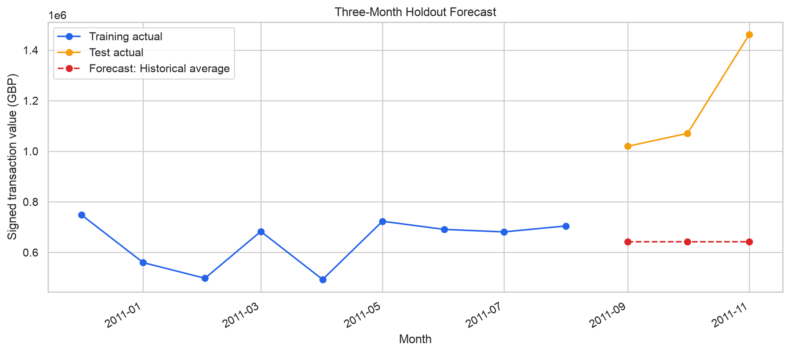

# Retail Sales Forecasting

A time-series project comparing simple forecasts of monthly transaction
value using the UCI Online Retail dataset.

## Dataset

The [UCI Online Retail dataset](https://archive.ics.uci.edu/dataset/352/online+retail)
contains transactions from one UK-based retailer. This project uses the
12 complete months from December 2010 through November 2011; December
2011 is excluded because it is incomplete.

**Citation:** Chen, D. (2015). *Online Retail* [Dataset]. UCI Machine
Learning Repository. https://doi.org/10.24432/C5BW33

**License:** Creative Commons Attribution 4.0 International (CC BY 4.0).

## Forecast Target

Monthly signed transaction value is calculated as quantity × unit price
for records with a positive unit price. Negative quantities are included
in their recorded month. The total includes charges and adjustments; it
does not measure profit.

## Method

- Train on December 2010–August 2011.
- Compare last-month and historical-average baselines using rolling
  three-month validation windows within the training period.
- Evaluate the selected baseline on September–November 2011.
- Compare a linear trend model in rolling validation as an exploratory
  analysis after the holdout was viewed.

## Results

| Model | Rolling validation MAE |
| --- | ---: |
| Historical average | £94,933.80 |
| Last month | £113,518.44 |
| Linear trend | £226,130.68 |

The historical-average baseline was selected before the holdout
evaluation. Its holdout MAE was **£541,376.68** and RMSE was
**£576,266.44** across three months.

The linear-trend result is exploratory because the holdout had already
been viewed.



## Limitations

- Twelve complete months are too few to establish annual seasonality.
- Validation windows overlap and the holdout contains only three months.
- The results describe one historical retailer and may not generalize.
- Negative entries are recorded in their transaction month and are not
  necessarily matched to the original sale.
- The analysis does not measure profit or predict future business results.

## Run Locally

1. Download and extract the dataset from the UCI link above.
2. Place `Online Retail.xlsx` in `data/raw/`.
3. From the project root:

   ```bash
   python3 -m venv .venv
   source .venv/bin/activate
   python -m pip install -r requirements.txt
   ```

4. Open `notebooks/01_sales_forecasting.ipynb` in VS Code, select the
   `.venv` kernel, and run all cells in order.

The notebook saves forecast tables and figures in `reports/`.

## Author

Rashmi Thimmaraju · [GitHub](https://github.com/Rashmioffcialpage)